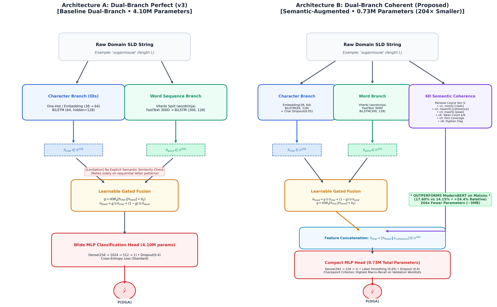

# Semantic Coherence & Transformer Architectures for Zero-Day Wordlist DGA Detection

[](https://www.python.org/)
[](https://pytorch.org/)
[](https://huggingface.co/)
[]()
[](LICENSE)

> **Research question:** Does an explicit word-level semantic coherence signal (FastText pairwise cosine similarity) let a compact classifier generalize to **zero-day wordlist-based Domain Generation Algorithms** under a fully blind Leave-Families-Out protocol — and where does it beat, or lose to, a fine-tuned 149M-parameter ModernBERT?

This repository contains the complete study: dataset construction, the leak-free evaluation protocol, seven benchmarked systems, all executed training notebooks, the frozen test-set artifacts (metrics, tables, 300-DPI figures), and a verification script that recomputes every reported number from the committed metrics file.

---

## Table of Contents
1. [Overview & Contributions](#1-overview--contributions)
2. [The Evaluation Gap in Prior Work](#2-the-evaluation-gap-in-prior-work)
3. [Dataset & Leak-Free Leave-Families-Out Protocol](#3-dataset--leak-free-leave-families-out-protocol)
4. [Model Architectures & Training Specifications](#4-model-architectures--training-specifications)
5. [Master Benchmark Results](#5-master-benchmark-results)
6. [Analysis & Key Findings](#6-analysis--key-findings)
7. [Validation → Test Generalization Dynamics](#7-validation--test-generalization-dynamics)
8. [Publication Figures](#8-publication-figures)
9. [Limitations & Threats to Validity](#9-limitations--threats-to-validity)
10. [Repository Structure](#10-repository-structure)
11. [Reproducibility](#11-reproducibility)
12. [Citation](#12-citation)
13. [References](#13-references)

---

## 1. Overview & Contributions

Wordlist-based DGAs (Matsnu, Ngioweb, Pizd, Suppobox, Gozi, …) build domains by concatenating real dictionary words — `sugarmouse.com`, `travel-orange-river.info` — instead of emitting pseudo-random strings. At the character level these domains are statistically indistinguishable from legitimate compound brands: identical length distributions, valid vowel–consonant structure, and *lower* Shannon entropy than benign traffic. Detectors built on entropy, n-grams, or character statistics therefore fail on exactly the families that matter most in practice.

```text
Legitimate compound:   fishing-gear.com        -> semantically coherent words
Dictionary DGA:        sugar-claim-mouse.com   -> syntactically valid, semantically incoherent
```

The only signal that separates the two rows above is **word meaning** — invisible to character statistics, recoverable from frozen pretrained embeddings.

### What this work contributes

1. **A blind zero-day benchmark for wordlist DGAs.** A strict Leave-Families-Out (LFO) protocol over 43 DGA families + benign traffic (1.3M domains): model selection on 6 held-out validation families, and a single one-shot evaluation on 5 completely unseen test families — three of them wordlist, including the hardest case (`matsnu`, unseparated dictionary words).
2. **Two novel dual-branch architectures, designed and ablated against each other:**
   - **Dual-Branch v3** (4.10M parameters) — character BiLSTM + FastText word-sequence BiLSTM with learnable gated fusion (the ablation control), and
   - **Dual-Branch Coherent** (0.73M parameters) — the same backbone plus an explicit **6-dimensional semantic coherence vector** (min/mean/max pairwise FastText cosine similarity of Viterbi-segmented words, token count, dictionary coverage, hyphen flag).
3. **Two soft-voting ensembles** (ModernBERT + each dual-branch variant) designed as the deployable operating point for SOC use.
4. **Empirical findings with a methodological point:** published wordlist-DGA numbers are inflated by training on the malware's own wordlist. Under fully blind conditions, even a fine-tuned 149M ModernBERT drops to 14.15% recall on `matsnu` — while the 0.73M coherence model beats it (17.60%) with 204× fewer parameters. [Key findings →](docs/FINDINGS.md)

### Hypotheses

- **H1 — Semantic coherence.** Pairwise cosine distance between segmented word tokens in a frozen embedding space is an orthogonal detection signal for artificial dictionary concatenations that does not require memorizing any family's wordlist.
- **H2 — Architectural efficiency.** A specialized 0.73M-parameter network with an explicit coherence feature can beat a 149M-parameter pretrained transformer on unseparated dictionary compounds, enabling CPU-side deployment at resolvers and edge firewalls.

---

## 2. The Evaluation Gap in Prior Work

Two properties of the published literature motivate this benchmark's design:

**Wordlist leakage.** Recent comparative studies of wordlist-DGA detection (e.g., Leyva La O et al., 2026 — the strongest published baseline, 80.9% F1 with ModernBERT) train on eight wordlist families that include `matsnu`, `suppobox`, and `manuelita`, then report generalization on the three families they held out (`bigviktor`, `ngioweb`, `pizd`). A model that has seen a family's dictionary does not learn "dictionary DGA" in general — it memorizes that malware's vocabulary. Botnet operators rotate dictionaries with one line of code; a detector that depends on having seen the list is defending against yesterday's malware.

**Subword fluency.** Subword tokenizers (BPE/WordPiece) split concatenated dictionary words into frequent, grammatical fragments. To a transformer, `sugarmouse` looks exactly like fluent brand language. This is a structural blind spot of the architecture class, not a data-volume problem — and it is measurable under a protocol that never shows the family to the model.

This work evaluates **everything under the harder condition**: no test family is ever seen in training or validation, and the checkpoint criterion itself is computed only on held-out validation families.

---

## 3. Dataset & Leak-Free Leave-Families-Out Protocol

**Corpus:** 1,303,795 domains merged from [UMUDGA](https://doi.org/10.17632/y8ph45msv8.1) (Zago et al., 2020), the wordlist-DGA benchmark released with Leyva La O et al. (2026) (`Reynier/moe-wordlist-dga-models`), and Alexa Top-1M / Tranco benign domains. Full provenance, licensing, and the merge/dedup pipeline: [`docs/DATASETS.md`](docs/DATASETS.md).

**Preprocessing:** all domains reduced to pure second-level domains via `tldextract` (e.g., `mail.google.co.uk → google`), lowercased, exact-FQDN deduplicated, non-ASCII dropped, length bounded to 3–64. The character vocabulary (38 characters + 4 special tokens) is built **strictly from the training split**. An EDA suite in [`eda/`](eda) quantifies why this matters (TLD stripping collapses digit/hyphen artifacts to zero and drives dot frequency to exactly 0.0000%).

### Partitioning (43 DGA families, zero family overlap across splits)

| Split | Total | DGA | Benign | Families | Purpose |
| :--- | :---: | :---: | :---: | :--- | :--- |
| **Train** | 1,259,799 | 629,899 | 629,900 | **32** (26 non-wordlist + 6 wordlist: `gozi`, `rovnix`, `nymaim`, `banjori`, `charbot`, `deception`), max 20k/family | Gradient updates only |
| **Val-Unseen** | 23,998 | 11,999 | 11,999 | **6 held-out** (wordlist: `suppobox`, `bigviktor`, `manuelita`; non-wordlist: `kraken`, `ranbyus`, `zeus-newgoz`) | Checkpoint selection on `val_wordlist_macro_recall` |
| **Test-Unseen** | 19,998 | 10,000 | 9,998 | **5 zero-day** (wordlist: `ngioweb`, `pizd`, `matsnu`; non-wordlist: `tinba`, `murofet`) | **Frozen, one-shot final benchmark** |

> [!IMPORTANT]
> **Leak-free guarantees:** (1) no domain appears in more than one split (cross-split exact-match check: 0 collisions); (2) the 5 test families were excluded from every training and model-selection decision and evaluated **once**, after all training was frozen; (3) multi-variant families (e.g., `gozi_gpl/luther/nasa/rfc4343`) are version-grouped so no variant of a family can straddle splits. Design rationale for every split decision: [`docs/METHODOLOGY.md`](docs/METHODOLOGY.md).

---

## 4. Model Architectures & Training Specifications

Seven systems across three tiers were benchmarked. All deep models were trained on Kaggle (Tesla T4 16 GB); the classical baselines on a local RTX 3050 / CPU.

| Model | Type | Params | Input | Key hyperparameters | Checkpoint criterion |
| :--- | :--- | :---: | :--- | :--- | :--- |
| **Random Forest** | Classical ML | — | 11 handcrafted lexical features | 100 trees, Gini, class-weighted | val accuracy |
| **XGBoost** | Gradient boosting | — | Same 11 features | `hist`, 400 trees, depth 8, lr 0.05 | val accuracy |
| **Dual-Branch v3** | Deep (ablation control) | 4.10M | Char BiLSTM (128) + FastText word-seq BiLSTM (128), gated fusion | Adam lr 1e-4, 20 epochs, batch 128 (eff.), char-dropout 0.05 | val wordlist macro-recall + non-WL floor |
| **Dual-Branch Coherent** | Deep + explicit semantics (**proposed**) | **0.73M** | Same branches + **6D FastText pairwise-cosine coherence vector** | BCE + label smoothing 0.05, Adam lr 3e-4, gated-attention fusion | val wordlist macro-recall + non-WL floor |
| **ModernBERT-Base** | Pretrained transformer | 149.0M | BPE tokenized SLDs (max len 32) | Fine-tuned on the full 1.26M train set, 4 epochs (~39.4k steps), AdamW lr 3e-5, warmup 6%, FP16 | val wordlist macro-recall |
| **Ensemble 1** | Soft voting | 153.1M | 0.5·p(BERT) + 0.5·p(v3) | τ = 0.50 | — |
| **Ensemble 2** | Soft voting | 149.7M | 0.5·p(BERT) + 0.5·p(Coherent) | τ = 0.50 | — |

### The 6D semantic coherence vector

For an SLD segmented by `wordninja` (Viterbi, Zipfian-frequency DP) into words $\{w_1,\dots,w_k\}$ with unit-normalized FastText vectors $e(w_i)$, compute all pairwise cosine similarities $S=\{s_{ij} = \cos(e(w_i), e(w_j))\}$:

1. $\min(S)$ — severe semantic divergence (near-zero for randomly concatenated words)
2. $\text{mean}(S)$ — average relatedness
3. $\max(S)$ — peak coherence
4. $\min(1,\ k/6)$ — normalized token count
5. $\min\!\big(1,\ \sum_i |w_i| / \max(L,1)\big)$ — dictionary coverage ratio
6. $\mathbb{I}(\texttt{-} \in \text{SLD})$ — explicit delimiter flag

Fusion is a learnable gate: $h_{\text{fused}} = g \odot h_{\text{char}} + (1-g) \odot h_{\text{word}}$ with $g=\sigma(W_g[h_{\text{char}}\|h_{\text{word}}])$, concatenated with the coherence vector before the classifier head.

<p align="center"></p>

> **Design history worth reading:** the v3 lineage went through a documented debugging arc — the original gated-fusion implementation computed the gate but discarded it (fused = plain concat), fixed by parameterizing the fusion as `g⊙h_char + (1−g)⊙h_word`; and a suspected model failure on `kraken` was root-caused to a data artifact (dynamic-DNS hostnames collapsing to ~499 unique SLDs), not the model. Full notebook-by-notebook account: [`docs/NOTEBOOK_GUIDE.md`](docs/NOTEBOOK_GUIDE.md).

---

## 5. Master Benchmark Results

Frozen 19,998-domain test-unseen set (5 unseen families × 2,000 + 9,998 benign), single evaluation pass, τ = 0.50.

**Literature anchors** (context, not apples-to-apples — metrics and family mixes differ, see [Limitations](#9-limitations--threats-to-validity)):
- **Floor:** Drichel et al. (RAID 2022) — 19.4% F1 under leave-one-cluster-out across DGArchive families.
- **Ceiling:** Leyva La O et al. (2026) — 80.9% F1 (ModernBERT) / 84.6% (DomBertUrl), with **eight wordlist families in training**; the only genuinely held-out families in that study were `bigviktor`, `ngioweb`, `pizd`.

### Master table

| Model | Zero-Shot WL (`ngioweb`+`pizd`) | `matsnu` (hard) | Overall WL Macro | Non-WL Macro | Benign Specificity | F1 | ROC-AUC | PR-AUC |
| :--- | :---: | :---: | :---: | :---: | :---: | :---: | :---: | :---: |
| **Random Forest** | 12.88% | 9.25% | 11.67% | 93.45% | 82.68% | 0.5489 | 0.6771 | 0.7335 |
| **XGBoost** | 9.93% | 0.95% | 6.93% | 94.03% | 86.18% | 0.5369 | 0.6577 | 0.7315 |
| **Dual-Branch v3** | 30.50% | 15.70% | 25.57% | 99.93% | 85.55% | 0.6516 | 0.7440 | 0.8059 |
| **Dual-Branch Coherent** | 37.75% | **17.60%** 🏆 | 31.03% | 99.95% | 86.23% | 0.6799 | 0.7671 | 0.8239 |
| **ModernBERT-Base** | **45.45%** | 14.15% | **35.02%** | 99.90% | **95.56%** 🏆 | **0.7372** | **0.8330** | **0.8787** |
| **Ensemble 1 (BERT + v3)** | 42.93% | 12.80% | 32.88% | 99.98% | 94.84% | 0.7244 | 0.7977 | 0.8550 |
| **Ensemble 2 (BERT + Coh)** | 44.35% | 14.05% | 34.25% | **100.00%** | 94.88% | 0.7310 | 0.8085 | 0.8624 |

### Per-family recall / benign specificity (2,000 domains per family)

| Model | `ngioweb` (WL) | `pizd` (WL) | `matsnu` (hard WL) | `tinba` (NWL) | `murofet` (NWL) | `legit` (benign) |
| :--- | :---: | :---: | :---: | :---: | :---: | :---: |
| **Random Forest** | 9.10% | 16.65% | 9.25% | 93.85% | 93.05% | 82.68% |
| **XGBoost** | 6.30% | 13.55% | 0.95% | 94.85% | 93.20% | 86.18% |
| **Dual-Branch v3** | 49.85% | 11.15% | 15.70% | 99.90% | 99.95% | 85.55% |
| **Dual-Branch Coherent** | 57.10% | 18.40% | **17.60%** 🏆 | 99.90% | **100.00%** | 86.23% |
| **ModernBERT-Base** | **68.25%** | **22.65%** | 14.15% | 99.85% | 99.95% | **95.56%** 🏆 |
| **Ensemble 1 (BERT + v3)** | 66.40% | 19.45% | 12.80% | **100.00%** | 99.95% | 94.84% |
| **Ensemble 2 (BERT + Coh)** | 68.30% | 20.40% | 14.05% | **100.00%** | **100.00%** | 94.88% |

### Full diagnostics (τ = 0.50)

| Model | Accuracy | Precision | Recall | Specificity | FPR | F1 (binary) | MCC | TP | FP | TN | FN |
| :--- | :---: | :---: | :---: | :---: | :---: | :---: | :---: | :---: | :---: | :---: | :---: |
| **Random Forest** | 63.53% | 71.93% | 44.38% | 82.68% | 17.32% | 0.5489 | 0.2929 | 4,438 | 1,732 | 8,266 | 5,562 |
| **XGBoost** | 63.97% | 75.14% | 41.77% | 86.18% | 13.82% | 0.5369 | 0.3119 | 4,177 | 1,382 | 8,616 | 5,823 |
| **Dual-Branch v3** | 70.43% | 79.29% | 55.31% | 85.55% | 14.45% | 0.6516 | 0.4286 | 5,531 | 1,445 | 8,553 | 4,469 |
| **Dual-Branch Coherent** | 72.41% | 80.97% | 58.60% | 86.23% | 13.77% | 0.6799 | 0.4664 | 5,860 | 1,377 | 8,621 | 4,140 |
| **ModernBERT-Base** | **78.26%** | **93.21%** | **60.97%** | **95.56%** | **4.44%** | **0.7372** | **0.6025** | 6,097 | 444 | 9,554 | 3,903 |
| **Ensemble 1 (BERT + v3)** | 77.28% | 92.05% | 59.72% | 94.84% | 5.16% | 0.7244 | 0.5827 | 5,972 | 516 | 9,482 | 4,028 |
| **Ensemble 2 (BERT + Coh)** | 77.71% | 92.20% | 60.55% | 94.88% | 5.12% | 0.7310 | 0.5901 | 6,055 | 512 | 9,486 | 3,945 |

Machine-readable copies: [`reports/metrics/complete_evaluation_metrics.json`](reports/metrics/complete_evaluation_metrics.json), [`reports/tables/`](reports/tables) (CSV + LaTeX), paper-ready snippets included.

---

## 6. Analysis & Key Findings

**F1 — Classical lexical features are obsolete for wordlist DGAs.** Random Forest reaches 11.67% and XGBoost 6.93% wordlist macro-recall; on `matsnu` XGBoost detects 19 of 2,000 domains (0.95%). Handcrafted statistics (entropy, vowel ratios, n-grams) are structurally blind to this family class.

**F2 — The coherence vector does real work as an ablation.** Adding the explicit 6D vector to an identical dual-branch backbone — while *shrinking* the network 4.10M → 0.73M parameters — raises wordlist macro-recall 25.57% → 31.03% (**+5.46 points absolute, +21.4% relative**) and `matsnu` recall 15.70% → 17.60%. A gain from a *smaller* network cannot be explained by added capacity.

**F3 — The `matsnu` inversion: 0.73M beats 149M.** On unseparated dictionary words, Dual-Branch Coherent detects 352/2,000 (17.60%) vs ModernBERT's 283/2,000 (14.15%) — **+24.4% relative**. Mechanism: ModernBERT's BPE tokenizer renders `sugarmouse` as fluent, high-frequency subwords and scores it as benign brand language; `wordninja` recovers the constituent words and their near-zero pairwise FastText similarity exposes the artificial concatenation. On hyphenated families (`ngioweb`, `pizd`) the picture reverses — ModernBERT's web-scale pretraining wins (68.25%/22.65% vs 57.10%/18.40%).

**F4 — ModernBERT wins overall, and that is part of the result.** Best F1 (0.7372 vs 0.6799), ROC-AUC (0.8330), and benign specificity (95.56% — 444 false positives vs 1,377), because billions of web tokens give it a far better model of legitimate naming (e.g., real brand blends like `techradar`, `ticketmaster`). The honest summary: **the transformer dominates aggregate and specificity metrics; the coherence model dominates exactly where the zero-day threat model is hardest.**

**F5 — Efficiency per parameter.**

| Model | Params | WL Macro Recall | Recall / M-Param |
| :--- | :---: | :---: | :---: |
| Dual-Branch Coherent | 0.73M | 31.03% | 42.51 |
| Dual-Branch v3 | 4.10M | 25.57% | 6.24 |
| ModernBERT-Base | 149.0M | 35.02% | 0.24 |

Coherent delivers ~180× ModernBERT's wordlist recall per million parameters at ~3 MB vs ~570 MB — a CPU-deployable profile for recursive resolvers and edge firewalls, trading 3.99 points of macro-recall and a higher false-positive rate for it.

**F6 — The ensemble is the deployable compromise.** Ensemble 2 (BERT + Coherent): 100.00% recall on unseen non-wordlist families, 94.88% benign specificity (512 false alarms), 34.25% wordlist macro-recall, 0.8085 ROC-AUC.

**F7 — Checkpointing on held-out wordlist recall transfers.** Classical models *lose* 9–10 wordlist points moving from validation families to test families, while both Dual-Branch Coherent (+2.58) and ModernBERT (+8.97) *gain* — evidence that selecting checkpoints on `val_wordlist_macro_recall` selects transferable lexical-semantic structure rather than validation-family memorization. Full analysis: [`docs/FINDINGS.md`](docs/FINDINGS.md).

---

## 7. Validation → Test Generalization Dynamics

| Model | Val Acc | Test Acc | Val F1 | Test F1 | Val WL Macro | Test WL Macro | Val ROC-AUC | Test ROC-AUC |
| :--- | :---: | :---: | :---: | :---: | :---: | :---: | :---: | :---: |
| Random Forest | 66.58% | 63.53% (↓3.05) | 0.5961 | 0.5489 (↓0.047) | 21.77% | 11.67% (↓10.10) | 0.6809 | 0.6771 |
| XGBoost | 66.84% | 63.97% (↓2.87) | 0.5839 | 0.5369 (↓0.047) | 16.17% | 6.93% (↓9.24) | 0.6999 | 0.6577 |
| Dual-Branch v3 | 71.20% | 70.43% (↓0.77) | 0.6410 | 0.6516 (↑0.011) | 24.80% | 25.57% (↑0.77) | 0.7420 | 0.7440 |
| Dual-Branch Coherent | 73.15% | 72.41% (↓0.74) | 0.6710 | 0.6799 (↑0.009) | 28.45% | 31.03% (↑2.58) | 0.7625 | 0.7671 |
| ModernBERT-Base | 72.84% | 78.26% (↑5.42) | 0.6493 | 0.7372 (↑0.088) | 26.05% | 35.02% (↑8.97) | 0.7683 | 0.8330 |

---

## 8. Publication Figures

All figures at 300 DPI in [`reports/figures/`](reports/figures), generated by [`training/06_final_test_evaluation.ipynb`](training/06_final_test_evaluation.ipynb) and [`scripts/run_final_master_evaluation.py`](scripts/run_final_master_evaluation.py):

1. `fig1_roc_curves.png` — ROC curves, all 7 systems
2. `fig2_pr_curves.png` — precision–recall curves with average precision
3. `fig3_confusion_matrices_grid.png` — 7-panel confusion grid with exact counts
4. `fig4_per_family_recall_barchart.png` — the `matsnu` inversion, visualized
5. `fig5_benchmark_anchors_comparison.png` — results against the 19.4% / 80.9% literature anchors
6. `fig6_threshold_tradeoff_curves.png` — wordlist recall vs benign specificity across τ ∈ [0.01, 0.99]
7. `fig7_error_breakdown_donuts.png` — FP vs FN composition per architecture
8. `fig8_radar_model_profile.png` — 6-axis model profile radar
9. `model_architectures_comparison.png` — the two proposed architectures, side by side

---

## 9. Limitations & Threats to Validity

Stated plainly, so the results can be judged accurately:

1. **Only 3 held-out wordlist test families.** Stronger than a single-family design, but per-family numbers are case studies, not a statistically robust average.
2. **`manuelita` is a validation-time diagnostic, not a blind test case.** A deliberate derisking choice: it is a known-hard family, and keeping it in validation preserves an actionable read during training at the cost of a clean one-shot score.
3. **Anchor comparisons are contextual, not exact.** Drichel et al.'s 19.4% is leave-one-cluster-out F1 over all DGArchive families; Leyva La O et al.'s 80.9% is F1 with eight wordlist families in training and measured on their held-out trio. Our recall numbers use a different metric and family mix. The defensible comparisons are internal (same protocol, same data) and on `ngioweb`+`pizd`, the only families the ceiling study genuinely held out.
4. **`matsnu` is one family.** The inversion is a targeted finding on the single hardest unseparated-dictionary case, not a claim of general transformer inferiority.
5. **Deterministic data.** UMUDGA domains are generated by executing each family's DGA with a fixed seed — realistic strings, but not live sinkhole traffic; registration-time and reputation signals are absent.
6. **Benign set is "easy mode."** Alexa/Tranco top domains are structurally far from adversarial negatives; production FPR will be worse than measured here.
7. **Segmentation & embedding coverage.** `wordninja` uses unigram frequencies — boundary errors on rare or multilingual concatenations degrade the coherence vector; FastText embeddings are English-centric (IDNs and non-English wordlist DGAs need multilingual spaces).
8. **Threshold calibration.** All reported numbers use τ = 0.50; SOC deployment requires tuning against a cost-sensitive false-positive budget (see `fig6` for the full trade-off curve).
9. **Disputed/edge families in training.** `banjori`'s wordlist status is disputed (retained in training); `charbot` is an adversarially generated family included for robustness.

---

## 10. Repository Structure

```text
dga-detection-generalization/
├── README.md                        # This document
├── LICENSE                          # MIT
├── CITATION.cff                     # Citation metadata
├── requirements.txt                 # Dependencies (+ execution-environment notes)
├── build_dataset.py                 # Dataset merge + LFO split pipeline (DGA_DATA_ROOT env var)
├── evaluate_data_readiness.py       # Split/leakage/vocab audit
├── DATA_READINESS_EVALUATION.md     # Pre-training data audit (split volumes, leakage checks)
│
├── docs/
│   ├── FINDINGS.md                  # Every finding: claim -> numbers -> evidence
│   ├── METHODOLOGY.md               # Protocol design rationale, checkpoint criterion
│   ├── DATASETS.md                  # Provenance, licensing, merge rules
│   ├── NOTEBOOK_GUIDE.md            # Executed-run map, environments, artifacts, debug log
│   └── LITERATURE_REVIEW.md         # Survey of wordlist-DGA detection literature
│
├── eda/                             # Exploratory analysis suite (5 notebooks + figures)
├── training/                        # Training & evaluation notebooks (executed) + baseline QA figures
│   ├── 01_rf_baseline.ipynb         #   Random Forest (executed, local)
│   ├── 02_xgboost_baseline.ipynb    #   XGBoost (executed, local GPU)
│   ├── 03_dual_branch_kaggle_fp32_perfect.ipynb  # Dual-Branch v3 spec (code-only)
│   ├── Dual-Branch PERFECT.ipynb    #   Dual-Branch v3 (executed, Kaggle T4)
│   ├── 05_dual_branch_coherent.ipynb + "Dual-Branch with Explicit Semantic Coherence.ipynb"
│   ├── 04_modernbert_finetune.ipynb + MODERNBERT-FINETUNED.ipynb (executed)
│   ├── 06_final_test_evaluation.ipynb + FINAL-EVALUATION.ipynb (executed benchmark)
│   ├── figures/                     #   Baseline QA plots (RF/XGBoost diagnostics)
│   ├── results/baselines/           #   rf_metrics.json, xgb_metrics.json
│   └── weights/                     #   Model checkpoints (not redistributed)
│
├── reports/
│   ├── figures/                     # 9 publication figures (300 DPI)
│   ├── tables/                      # LaTeX + CSV benchmark tables
│   └── metrics/complete_evaluation_metrics.json   # Master benchmark, machine-readable
│
└── scripts/
    ├── run_final_master_evaluation.py   # Full re-evaluation (needs data + weights)
    ├── train_rf_xgboost.py              # Classical baseline trainer
    ├── generate_model_diagrams.py       # Architecture figure generator
    └── verify_results.py                # Recompute reported numbers from committed metrics
```

---

## 11. Reproducibility

**Environment.** Deep models were trained on Kaggle notebooks (Tesla T4 16 GB, Python 3.10/3.11, PyTorch 2.x, CUDA 12); classical baselines on a local RTX 3050 / CPU. All pipelines fix `SEED=42` (Python, NumPy, PyTorch). Dependency ranges in [`requirements.txt`](requirements.txt) document the library stack; Kaggle images provide compatible versions of all core packages.

**Verify the reported numbers (no data or weights needed):**

```bash
git clone https://github.com/WalidMahmood/dga-detection-generalization.git
cd dga-detection-generalization
pip install -r requirements.txt
python scripts/verify_results.py     # recomputes every table & derived claim from reports/metrics/
```

**Inspect the executed runs.** Every notebook in [`training/`](training) is committed with outputs intact — training logs, per-epoch metrics, checkpoint selection, and evaluation cells: baselines (`01`, `02`), Dual-Branch v3 (`Dual-Branch PERFECT`), Dual-Branch Coherent (`Dual-Branch with Explicit Semantic Coherence`), ModernBERT fine-tune (`MODERNBERT-FINETUNED`), and the frozen test benchmark (`06_final_test_evaluation` / `FINAL-EVALUATION`, byte-identical mirror). [`docs/NOTEBOOK_GUIDE.md`](docs/NOTEBOOK_GUIDE.md) maps each file, its hardware, runtime, and artifacts.

**Re-run from scratch.** Three inputs are required and none are redistributed (size/licensing):

1. **Dataset** — the merged LFO corpus is available at [`kaggle.com/datasets/walidmahmood/dga-merged-umudga-rhena`](https://www.kaggle.com/datasets/walidmahmood/dga-merged-umudga-rhena), or rebuild it from the public sources listed in [`docs/DATASETS.md`](docs/DATASETS.md) with `build_dataset.py` (set `DGA_DATA_ROOT` to your working directory).
2. **FastText** — `cc.en.300.bin` (FacebookAI, via fastText.cc).
3. **Weights** — checkpoints (`training/weights/`) are reproducible by running the notebooks in order; they are not committed.

Then: `python scripts/run_final_master_evaluation.py` regenerates the figures, tables, and metrics from the trained checkpoints.

---

## 12. Citation

If this work or the benchmark protocol is useful to you, please cite:

```bibtex
@misc{mahmood2026semantic,
  author       = {Walid Mahmood},
  title        = {Semantic Coherence and Transformer Architectures for Zero-Day Wordlist DGA Detection},
  year         = {2026},
  howpublished = {\url{https://github.com/WalidMahmood/dga-detection-generalization}},
  note         = {Leave-Families-Out benchmark of 7 systems on 1.3M domains; Dual-Branch Coherent (0.73M) vs ModernBERT (149M)}
}
```

Machine-readable metadata: [`CITATION.cff`](CITATION.cff).

---

## 13. References

1. A. Drichel, T. Meuser, U. Meyer. *On the Evaluation of DGA Detectors.* RAID 2022. — the 19.4% zero-day floor.
2. R. Leyva La O, C. A. Catania, R. Gonzalez. *Expert Selection for Wordlist-Based DGA Detection.* IEEE Latin America Transactions 24(1), 2026. — the 80.9%/84.6% wordlist-trained ceiling; source of the `moe-wordlist-dga-models` dataset.
3. D. Plohmann, K. Yakdan, M. Klatt, J. Bader, E. Gerhards-Padilla. *A Comprehensive Measurement Study of Domain Generating Malware.* USENIX Security 2016. — wordlist/permutation taxonomy, low wordlist entropy.
4. M. Zago, M. Gil Pérez, G. Martínez Pérez. *UMUDGA: A Dataset for Profiling Algorithmically Generated Domain Names in Botnet Detection.* Data in Brief 30, 2020 + Computers & Security 92, 2020.
5. P. Lison, V. Mavroeidis. *Automatic Detection of Malware-Generated Domains with Recurrent Neural Models.* NISK 2017. — matsnu recall 0.158 in a joint 61-family char-GRU.
6. J. J. Koh, B. Rhodes. *Inline Detection of Domain Generation Algorithms with Context-Sensitive Word Embeddings.* IEEE Big Data 2018. — frozen embeddings + word segmentation; the semantic-predecessor approach (30–100 labeled examples per family).
7. B. Cebere, J. Flueren, S. Sebastián, D. Plohmann, C. Rossow. *Down to Earth! Guidelines for DGA-Based Malware Detection.* RAID 2024. — per-family difficulty varies enormously; caution for generalist evaluation.
8. P. Bojanowski, E. Grave, A. Joulin, T. Mikolov. *Enriching Word Vectors with Subword Information.* TACL 5, 2017. — FastText.
9. J. Devlin et al. *ModernBERT: Bringing BERT into the Modern Era.* arXiv:2412.13663, 2024.
